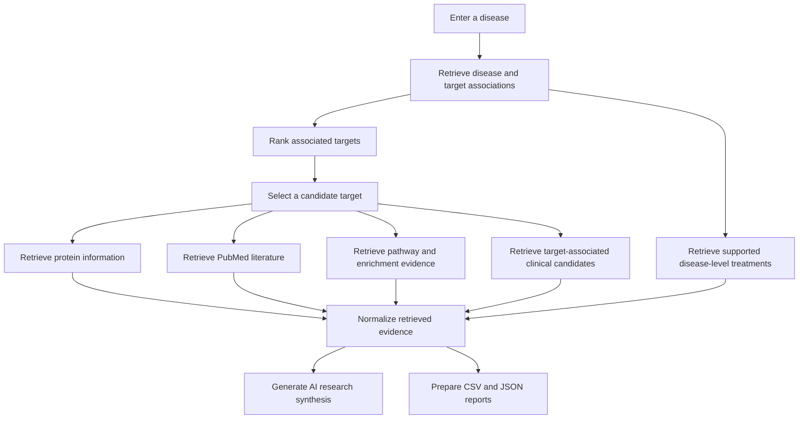

# Dyscovery — Disease-to-Target Research Lab

Dyscovery is a Python-based bioinformatics research application for identifying, prioritizing, and interpreting disease-associated therapeutic targets using evidence retrieved from biomedical databases. It combines target prioritization, molecular and pathway information, clinical candidate data, and AI-assisted research synthesis in an interactive Gradio dashboard.

**Research use only:** Dyscovery supports exploratory analysis and target prioritization. It does not provide medical advice or establish clinical efficacy.

## Features

- **Disease search and target prioritization:** Retrieve disease-associated targets through Open Targets and rank them using database association scores.
- **Protein information:** Retrieve protein records from UniProt.
- **Literature evidence:** Retrieve matching PubMed publications, including available titles, PMIDs, publication dates, links, and abstracts when available.
- **Pathway analysis:** Explore Reactome pathway information.
- **Protein association networks:** Display STRING network evidence when available.
- **Functional enrichment:** Present Gene Ontology (GO) and KEGG pathway enrichment results when available.
- **Clinical candidates:** Explore target-associated drug candidates and available clinical-stage or mechanism information.
- **Disease-level treatments:** Display curated treatment information for supported diseases, including familial hypercholesterolemia (FH), separately from target-associated candidates.
- **AI research synthesis:** Generate an evidence-grounded narrative interpreting retrieved findings, target prioritization, literature, pathways, therapeutic evidence, limitations, and research gaps.
- **Exports:** Download ranked target results as CSV and detailed analysis information as JSON.
- **Testing:** Automated tests using pytest.

## Research Workflow



## Technology Stack

- **Language:** Python
- **Interface:** Gradio
- **Data processing:** pandas
- **AI research synthesis:** Groq API
- **Testing:** pytest
- **Biomedical evidence:** Open Targets, UniProt, PubMed, Reactome, STRING, Gene Ontology, and KEGG, depending on the implemented retrieval services and available data.

## Installation

### 1. Clone the repository

```bash
git clone https://github.com/wani34basit1-ctrl/DiseaseToTargetAgent.git
cd DiseaseToTargetAgent
```

### 2. Create and activate a virtual environment

```bash
python3 -m venv .venv
source .venv/bin/activate
```

On Windows, use:

```powershell
.venv\Scripts\Activate.ps1
```

### 3. Install dependencies

```bash
python -m pip install --upgrade pip
python -m pip install -r requirements.txt
```

### 4. Configure the Groq API key

Create a `.env` file in the project root:

```env
GROQ_API_KEY=your_api_key_here
```

Replace the placeholder with your own API key.

The AI synthesis feature requires valid Groq API credentials. Other application functionality may depend on the availability of its respective data services.

## Run the Application

Launch the Gradio dashboard:

```bash
python app.py
```

Open the local URL printed in the terminal by Gradio. Enter a disease or condition, select the number of targets, and run the search.

Review the results in their respective tabs. The Research Synthesis section provides an AI-generated narrative based on normalized evidence retrieved by the application.

## Testing

Run the automated test suite:

```bash
pytest -q
```

The tests cover implemented research services, evidence handling, citation validation, tool selection and execution, and AI research synthesis.

## Understanding the Results

- **Association scores:** Represent database-supported disease–target association signals. They are not probabilities of clinical efficacy.
- **Target prioritization:** A highly ranked target is a candidate for further investigation, not automatically a validated therapeutic target.
- **STRING evidence:** Protein association evidence does not necessarily establish direct physical binding or causality.
- **Pathway enrichment:** Indicates statistical or database-supported functional associations; it does not independently prove a disease mechanism.
- **Clinical candidates:** A drug associated with a target is not necessarily approved or effective for the disease being analyzed.
- **Disease-level treatments:** Curated disease treatments are presented separately from target-associated candidates. Their inclusion does not establish that they act directly on the selected target.
- **AI research synthesis:** Interpretations are constrained by retrieved evidence, but generated text can still contain errors. Verify scientific claims against the original sources.

Data availability varies by disease, target, and external service. Missing evidence should not be interpreted as proof that no evidence exists.

## Data Sources

- [Open Targets Platform](https://platform.opentargets.org/)
- [UniProt](https://www.uniprot.org/)
- [PubMed](https://pubmed.ncbi.nlm.nih.gov/)
- [Reactome](https://reactome.org/)
- [STRING](https://string-db.org/)
- [Gene Ontology](https://geneontology.org/)
- [KEGG](https://www.genome.jp/kegg/)
- [Groq](https://groq.com/)

## Limitations

Dyscovery is intended for educational and research purposes. Its results depend on database coverage, retrieval quality, source annotations, and model-generated interpretation. All findings require independent scientific review and, where appropriate, experimental validation. The application is not a clinical decision-support system and does not replace professional medical judgment.


